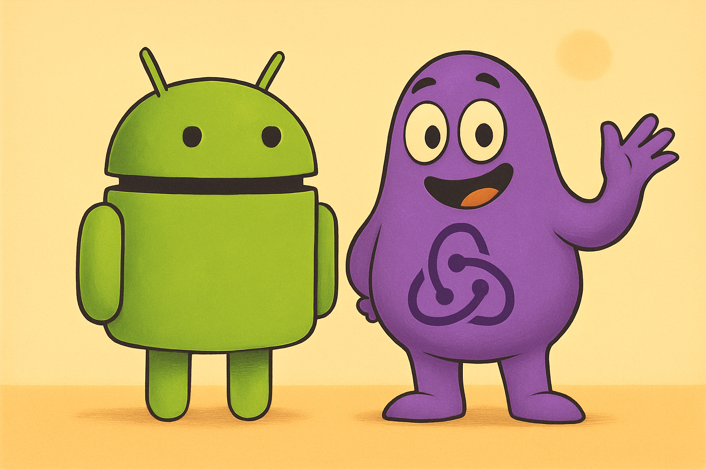

# Ghettoxide

Ghettoxide is a lightweight Redux-style architecture for modern Android apps.
It keeps the core model small:

- `Reducer<S, A, E>` owns business logic
- `StoreViewModel<S, A, E>` owns serialized action processing plus state/effects
- Compose or Fragment UI collects state with lifecycle-aware APIs

The library now includes first-class tab support for:

- app-level bottom tabs
- nested feature tabs
- tab reselection behavior
- tab restore behavior
- explicit hidden/visible callbacks
- lifecycle-safe effect collection
- keyed background jobs that cancel cleanly when tabs go offscreen

## Core ideas

### Reducers stay explicit

Reducers still process actions, mutate immutable state, and emit one-off effects:

```kotlin
class HomeReducer(
    private val repository: FeedRepository
) : TabChildReducer<HomeState, HomeAction, HomeEffect>() {

    override fun onLoadAction(): HomeAction? = null

    override fun onTabSelected(context: TabLifecycleContext): HomeAction? {
        return if (currentState.items.isEmpty()) HomeAction.Load else null
    }

    override fun onTabReselected(context: TabLifecycleContext): HomeAction? {
        return HomeAction.TabReselected
    }

    override suspend fun process(action: HomeAction) {
        when (action) {
            HomeAction.Load -> loadFeed(reset = true)
            HomeAction.TabReselected -> emit(HomeEffect.ScrollToTop)
        }
    }
}
```

### Tabs are reducer-driven, not magic

The tab layer is intentionally small:

- `TabId`
- `TabRoute`
- `TabSpec`
- `TabHostState`
- `TabHostAction`
- `TabHostReducer`
- `TabChildReducer`
- `TabVisibilityState`
- `TabLifecycleContext`

`TabHostReducer` owns tab selection, reselection counts, restore counts, and backstack behavior.
Each tab still gets its own reducer and `StoreViewModel`.

### Lifecycle safety is a first-class goal

The library bakes in the patterns that are easy to get wrong in tab-heavy apps:

- `onLoadAction()` now runs once when the store is created, not on every view recreation.
- `ObserveEffects(...)` uses `repeatOnLifecycle`.
- `StoreContent(...)` and `ReducerContent(...)` use `collectAsStateWithLifecycle`.
- `collectInScopeLatest(key, flow, ...)` guarantees one keyed collector per reducer job.
- `onTabHidden(...)` can cancel expensive work explicitly.
- `TabHost(...)` uses `SaveableStateHolder` so tab-local `rememberSaveable` UI state survives switching.
- `rememberTabHostController(...)` collects tab host state for you and exposes `selectTab(...)` / `goBack()` helpers.

## Add a tab

Adding a tab is meant to feel standardized:

```kotlin
enum class AppTab(
    override val stableKey: String,
    val label: String
) : TabId {
    Home("home", "Home"),
    Search("search", "Search")
}

fun searchTabSpec(
    onNavigate: (Destination) -> Unit
): TabSpec<AppTab> = reducerTabSpec(
    id = AppTab.Search,
    title = AppTab.Search.label,
    initialState = SearchState(),
    reducerFactory = { SearchReducer(repository) },
    onEffect = { effect ->
        if (effect is SearchEffect.NavigateToCreator) {
            onNavigate(Destination.Creator(effect.handle))
        }
    }
) { sceneState, state, effects, reducer ->
    SearchScreen(
        sceneState = sceneState,
        state = state,
        effects = effects,
        onAction = reducer::postAction
    )
}
```

Then wire the host:

```kotlin
val tabHost = rememberTabHostController(
    key = "app-shell-tabs",
    initialTabId = AppTab.Home
)

TabHost(
    controller = tabHost,
    tabs = listOf(
        homeTabSpec(onNavigate),
        searchTabSpec(onNavigate)
    )
)
```

## Example app

The tab showcase now lives in the `tabshowcase/` module, while `app/` stays as the smaller baseline demo.

`tabshowcase/` demonstrates:

- bottom tabs: `Home`, `Search`, `Notifications`, `Profile`
- nested `Profile` tabs: `Uploads`, `Liked`, `Collections`
- forward navigation from a tab into a typed clip detail route
- reselection-driven scroll-to-top
- nested tab back behavior
- reducer-owned scroll/filter/query/pagination state
- a live notifications flow that pauses while hidden
- loading, empty, error, and retry states
- effect-based navigation without storing UI objects inside reducers

`app/` remains the lightweight todo sample for the core reducer mental model.

## Docs

- General architecture: [`DOC.md`](DOC.md)
- Tab system and lifecycle rules: [`docs/tabs.md`](docs/tabs.md)
- Contributor guide: [`AGENTS.md`](AGENTS.md)

## Installation

```kotlin
dependencyResolutionManagement {
    repositories {
        google()
        mavenCentral()
        maven("https://jitpack.io")
    }
}
```

```kotlin
dependencies {
    implementation("com.github.Cortlandd:Ghettoxide:1.1.0")
}
```
